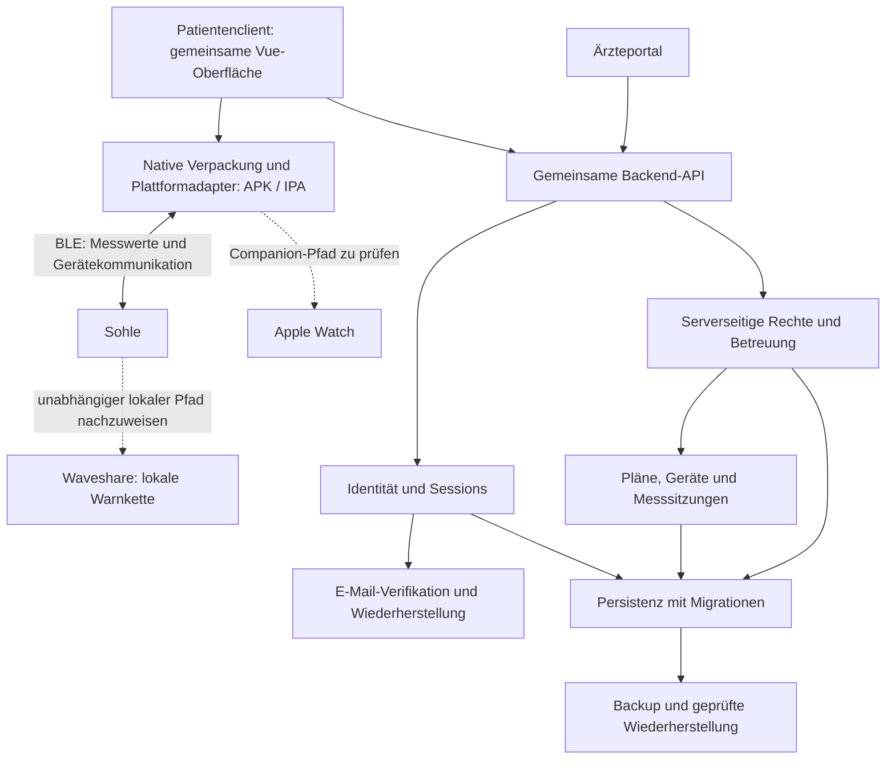

# Softwareanforderungen und Produktmeilensteine

Stand: 06.11.2026. **Arbeitsentwurf zur Anforderungsklärung**, keine Freigabe und kein Nachweis einer produktiven/medizinischen Einsatzfähigkeit. Zielauftrag: auf der alten App aufbauen, Frontend und Backend umfassend überarbeiten, Arzt-/Patientenkonten und Sicherheits-/DSGVO-Vorkehrungen ergänzen. Bestätigte Kernentscheidungen stehen in Abschnitt 2; weitere Detailfunktionen unten sind begründete Vorschläge, bis sie abgestimmt sind. Hardwarebasis des eigenständigen Armbands ist auf Nutzerentscheidung Waveshare ESP32-S3-Touch-LCD-1.28; weitere Komponenten, Provider und Frameworkänderungen sind nicht ausgewählt.

## 1. Was „produktreif“ hier konkret bedeutet

Das Ziel ist ein betreibbares Gesamtsystem mit sicheren, nachvollziehbaren Nutzerabläufen und belegten Grenzen. Ein schönes Dashboard, vorhandene Datenbank oder erfolgreicher Build allein genügt nicht. Zu unterscheiden sind technische Abnahme, datenschutzrechtliche Betriebsfähigkeit und die fachlich/regulatorisch erforderliche Freigabe für den beabsichtigten medizinischen Einsatz.

**Bestätigt durch Nutzerauftrag:** alte App als funktionale Referenz, umfassende Überarbeitung, Arzt und Patient mit jeweils eigenen Funktionen, vollständiges Frontend/Backend, Sicherheit und Datenschutz als Produktanforderungen. Die lokale unabhängige Warnkette bleibt aus dem bisherigen Projektrahmen maßgeblich.

**Einsatzfolge bestätigt:** beaufsichtigter Pilot zuerst, regulärer Einsatz nach erforderlicher Freigabe. Ein Pilot ist keine pauschale Ausnahme von Sicherheits-, Datenschutz- oder sonstigen anwendbaren Voraussetzungen. **Noch festzulegen:** Verantwortlicher/Betreiber, konkretes Pilotsetting, Zielmärkte, vorgesehene Nutzer, klinischer Zweck und Aussagen zur Verlässlichkeit. EU-MDR-Einordnung, einschlägige Entwicklungs-/Risikomanagementanforderungen und notwendige Nachweise fachlich bestimmen; keine Klasse/Zulassung ohne Prüfung behaupten. Echte Gesundheitsdaten oder Patientenbetrieb erst nach den dafür erforderlichen Freigaben.

Der alte 300/600-Stunden-Plan bleibt als bisherige Semesterplanung erhalten. Das zusätzliche Ärzteportal und die vollständige Betriebs-/Freigabearbeit sind darin **nicht belastbar geschätzt**. Für das neue Produktziel Umfang und Aufwand neu schätzen; weder ein marktreifes System noch dessen medizinische Freigabe für den 28.01.2027 zusagen. Semesterlieferung und anschließende Produktfreigabe nach der Klärung ausdrücklich zuordnen.

## 2. Bestätigte Kernentscheidungen und offene Abgrenzung

Vom Nutzer am 20.10.2026 bestätigt:

| Frage | Verbindliche Entscheidung | Konsequenz |
|---|---|---|
| Arzt-/Patientenzuordnung | Patient bestätigt Einladung eines geprüften Arztes | Arztprüfung vor Einladung; explizite Beziehungsaktivierung statt Zugriff allein durch Kenntnis einer E-Mail |
| Medizinische Belastungsgrenze | Arzt legt fest, Patient sieht und bestätigt die Geräteübernahme | Patient kann medizinischen Wert nicht frei überschreiben; jede Änderung mit Autor/Version |
| Erste Smartphoneplattformen | Installierbare Patienten-App für iPhone und Android, Ziel App Store/Google Play | Datenweg auf beiden Plattformen nachweisen; Web-Bluetooth allein nicht als allgemeine Lösung voraussetzen |
| Zusätzlicher Watch-Client | Apple Watch von Beginn an mitplanen; iPhone, Android, Waveshare und Apple Watch laut Nutzer verfügbar | Apple Watch zuerst real testen; Modelle/OS und zugesagte Funktionen klären. iPhone-Buildweg über GitHub Actions/macOS-Runner und AltServer auf Windows ist vereinbart, aber noch nicht praktisch erprobt; Watch-Build/Installation separat prüfen. Wear OS später |
| Erste Einsatzform | Beaufsichtigter Pilot, regulärer Einsatz erst nach Freigabe | Pilotumfang, Betreuung und eigene Abnahme definieren |
| Behandlerzahl | Genau ein verantwortlicher Arzt pro Patient; Arztwechsel unterstützt | Keine gleichzeitig gleichberechtigten Behandler in Version 1; Zuständigkeitswechsel historisieren |
| Lokaler Messdatenweg | Sohle schickt Messwerte an das Handy | Diesen BLE-Pfad für beide Smartphoneplattformen prüfen; Backend-Übertragung ist ein zweiter Schritt |
| Eigenständiges Armband | Waveshare ESP32-S3-Touch-LCD-1.28 als Hardwarebasis | Eigene Firmware für Anzeige/lokale Warnung; exakte Revision, Akku/Ladung, Haptik und BLE-Pfad noch nachweisen |

Patientenbestätigung und technische Gerätebestätigung unterscheiden: Die App darf einen Plan erst als am Armband angewendet anzeigen, wenn das tatsächliche Gerät die richtige Version bestätigt. Eine Benutzeraktion allein reicht nicht. Verhalten bei ausstehender Bestätigung oder abgelaufenem Plan muss festgelegt werden.

**Arztwechsel:** Neue Betreuung erst nach definiertem Einladungs-/Bestätigungsablauf aktivieren, alten Zugriff nach Regel beenden und zu jedem Zeitpunkt höchstens einen verantwortlichen Arzt führen. Historischen Plan samt Autor erhalten; Entscheidung über weitere Gültigkeit des Plans während des Wechsels ausdrücklich treffen. Keine ungefragte Übernahme alter ärztlicher Zugriffsrechte.

**Datenweg auseinanderhalten:** Sohle → Handy (lokaler Empfang per BLE) ist der bestätigte Ausgangspunkt. Handy → Backend (Internetübertragung) ermöglicht gespeicherte Sitzungen und Arztzugriff. Offen ist, wann dieser zweite Schritt passiert: während aktiver App, zusätzlich im Hintergrund oder nach Offlinephasen. Eine Offline-Queue auf dem Handy kann nur bereits empfangene Daten sichern; Messungen ohne BLE-Empfänger benötigen Speicher am Messgerät/Armband oder müssen als Lücke kenntlich bleiben. Keinen Gerätepuffer aus der früheren Frage als beschlossen ableiten.

**Unabhängiges Armband:** Der bestätigte Handyempfang hebt die bisherige lokale Warnanforderung nicht auf. Direkter Armbandempfang, Parallelverbindung oder anderer lokaler Pfad sind weiterhin nachzuweisen. Das Waveshare-Gerät ist jetzt als Hardwarebasis des unabhängigen Warnarmbands bestätigt. Zusätzliche gängige Smartwatches stehen im [Arbeitsbereich WATCH](watch-compatibility.md); nicht ungeprüft Sohle → Handy → Uhr als autonome Warnkette ausgeben. Ein ESP32-Board mit Touchdisplay ist kein Nachweis von Motor, Akku, fertigem Gehäuse oder zuverlässiger Warnfunktion.

Weitere offene Fragen: konkrete Arztprüfung, Zugriffs-/Aufbewahrungsregeln nach Arztwechsel, gültiger Plan während des Wechsels, Uploadzeitpunkt, Offlinedauer/Puffergrenzen, Geräteteilung, Praxismodell, Hostingbudget und Support.

## 3. Vorgeschlagene Kernabläufe

**Patient:** Konto erstellen/verifizieren → Betreuung zuordnen → Gerät verbinden → gültigen Therapieplan und tatsächlich angewendete Grenze prüfen → Messsitzung mit lokalem Armband durchführen → Upload-/Fehlerstatus sehen → eigene Verläufe nachvollziehen → Daten exportieren oder Datenschutzanfrage stellen.

**Arzt:** Berechtigung bestätigen → anmelden → bestätigte Patientenbeziehungen sehen → Patient öffnen → Plan/Grenze mit Gültigkeit festlegen → Übernahmezustand am Gerät erkennen → zugeordnete Verläufe und Qualitätsgrenzen auswerten → Betreuung beenden bzw. freigegebenen Bericht erstellen.

**Betrieb:** Dienste bereitstellen → Monitoring/Backups prüfen → Störungen bearbeiten → Konten/Geräte sicher sperren → Wiederherstellung und Datenschutzanfragen nach dokumentierten Abläufen durchführen. Kein vollständiges Adminportal oder Nachrichtensystem auf Vorrat; nötige Betriebsfunktionen können zunächst abgesicherte Werkzeuge sein.

## 4. Rollen und Zugriff – vorgeschlagene Regeln

| Fähigkeit | Patient | Arzt |
|---|---|---|
| Eigenes Konto/Profil verwalten | Ja | Ja |
| Eigene Messdaten ansehen/exportieren | Ja | Nur wenn selbst betroffene Person in einem ausdrücklich unterstützten Ablauf |
| Fremde Messdaten ansehen/exportieren | Nein | Nur bei erlaubter aktiver Beziehung und passendem Zweck |
| Medizinischen Plan festlegen | Nein; nur Anzeige und Bestätigung | Ja, für ausdrücklich zugeordnete Patienten |
| Geräte verbinden/Upload auslösen | Eigene zugewiesene Geräte | Gerätestatus zugeordneter Patienten lesen; Änderung nur nach definiertem Ablauf |
| Beziehungen freigeben/beenden | Nach vereinbartem Betreuungsmodell | Nach vereinbartem Betreuungsmodell |
| Sich selbst Arzt-/Adminrechte geben | Nein | Nein |

Technischer Betrieb hat standardmäßig keinen fachlichen Zugriff auf Patientenverläufe. Falls ein besonderer Supportzugriff nötig ist: zeitlich begrenzt, autorisiert und protokolliert. Eine etwaige Aufbewahrung ärztlicher Unterlagen ist vom normalen Plattformzugriff nach Beziehungsende gesondert zu bestimmen. Rollen allein reichen nicht: Eigentum, Beziehung, Zweck und Freigabestatus auf dem Server prüfen.

## 5. Funktionale Anforderungen und Abnahme

Alle IDs sind Produktanforderungen, **keine bereits implementierten Funktionen**. „Kern“ bezeichnet den vorgeschlagenen Umfang der ersten produktiven Version; ausstehende Modellentscheidungen können ihn verändern. Bestätigte Rollen-/Plan-/Plattformvorgaben gelten bereits. Nicht in den alten Backlog einrechnen, bevor Umfang und Schätzung aktualisiert wurden.

| ID | Bereich | Kernanforderung | Konkrete Abnahme |
|---|---|---|---|
| ACC-01 | Konten | Registrierung, E-Mail-Verifikation, Login/Logout, Passwortreset mit bewährter Auth-Lösung | Abgelaufener/erneut verwendeter Reset-Link scheitert; Logout beendet serverseitig den Zugang |
| ACC-02 | Rollen | Serverseitige Rollenprüfung; Arztzugang erst nach definiertem Nachweis/Einladung | Patient kann weder per UI noch direktem HTTP-Aufruf Arzt werden; ungeprüftes Arztkonto kann keine Betreuungseinladung versenden |
| ACC-03 | Sitzungen | Sichere Session, erneute Authentifizierung für sensible Änderungen, Sitzungen widerrufen | Gestohlene/alte Session nach Widerruf unbrauchbar; kein Health-API-Zugriff ohne gültige Session |
| ACC-04 | Schutz | MFA für Arztkonten, gesicherte Wiederherstellung, Login-/Reset-Ratenbegrenzung | MFA-Verlust hat nachvollziehbaren Recoveryweg ohne Umgehung der Identitätsprüfung |
| REL-01 | Betreuung | Einladungen mit Ablauf/Einmalnutzung, ausdrückliche Zuordnung und Liste aktiver Beziehungen | Einladung kann nicht mehrfach oder von falscher Identität übernommen werden |
| REL-02 | Betreuung | Datenzugriff nur für erlaubte Beziehung; Beendigung/Sperrung nachvollziehbar | Arzt A erhält nie Daten von Patient B ohne zulässige Zuordnung; Entzug greift serverseitig einschließlich vorhandener Sessions |
| REL-03 | Arztwechsel | Höchstens ein verantwortlicher Arzt; Wechsel nachvollziehbar und ohne Rechteübernahme | Gleichzeitige/erneute Einladungsannahmen schaffen keine zwei aktiven Verantwortlichen; alter Zugriff und Plangültigkeit nach festgelegtem Wechselmodell geprüft |
| PAT-01 | Patient | Startansicht mit Plan, bestätigter Grenze, Geräte-/Uploadstatus und eindeutigen Hinweisen | Kein Gerät/keine Daten erscheint nicht als 0 kg oder „alles sicher“ |
| PAT-02 | Patient | Eigene Sitzungen, Verlauf, Überschreitungen, Qualität und Feedback | Eine eigene Sitzung lässt sich nach erneutem Login samt Verlauf wieder öffnen |
| DOC-01 | Arzt | Patientenübersicht mit Suche und Betreuungsstatus | Keine global durchsuchbare Patientenliste; Suchergebnisse auf erlaubte Beziehungen beschränkt |
| DOC-02 | Arzt | Patientenansicht mit Planhistorie, Sitzungen und Messqualität | Zeitfilter, fehlende Messabschnitte und Überbereich sind sichtbar; keine erfundene Vollständigkeit |
| PLN-01 | Plan | Versionierter Belastungsplan: Grenzwert, Einheit, Autor, Erstellzeit, Gültigkeit und Änderungshistorie | Historische Sitzung bewertet nach damals wirksamem Plan, nicht nach aktuellem Grenzwert |
| PLN-02 | Synchronisierung | Sollwert und angewendeter Gerätewert mit Bestätigung/Version trennen | Fehlende/abgebrochene Übertragung zeigt „ausstehend“, nie „angewendet“ |
| PLN-03 | Ausfall | Verhalten bei unbekanntem/abgelaufenem Plan und Offline-Konflikt festlegen | Geräte-/App-Neustart und Offline-Änderung führen zu dokumentiertem Zustand; keine stille Grenzwertänderung |
| DEV-01 | Geräte | Gerät anhand stabiler Identität zuordnen, benennen, entfernen; Verlust/Wechsel behandeln | Fremdes oder bereits zugeordnetes Gerät kann nicht allein über erratene ID übernommen werden |
| DEV-02 | Gerätestatus | Verbindung, letzter Kontakt, Akku, Firmware und Messqualität soweit unterstützt | Nicht verfügbare Hardwareinformation wird als unbekannt statt erfunden angezeigt |
| DEV-03 | Wechsel | Sichere Übergabe/Zurücksetzung mit Löschung alter Bindungen und verbleibender lokaler Daten | Neu zugeordneter Patient erhält keine Daten oder Konfiguration des vorherigen Nutzers |
| DAT-01 | Messformat | Version, Einheit, Wertebereich, Sequenz, Geräte-/Empfangszeit, Qualitäts-/Überbereichsstatus | Kurze Pakete, NaN, Replay und unsupported Versionen werden definiert behandelt |
| DAT-02 | Messsitzung | Nutzer, Gerät, Zeitbasis, wirksame Planversion, Quelle real/demo und Qualitätsstatus speichern | Ein Datenpunkt ist eindeutig zuordenbar; Testdaten verändern keine echten Therapieverläufe |
| DAT-03 | Upload | Gewählter Gateway unterstützt gepufferten, authentifizierten und idempotenten Upload | Abbruch/Wiederholung erzeugt keinen Datenverlust innerhalb der zugesagten Puffergrenze und keine Duplikate |
| DAT-04 | Zeit/Verlauf | Datenlücken, Zeitzonen/Sommerzeit und Uhrabweichungen behandeln | Ein Tag/Sitzungsintervall wird reproduzierbar ausgewertet; Gerätezeit nicht als echte UTC ausgeben |
| ALT-01 | Warnkette | Belastungswarnung lokal am Armband, einschließlich Datenalter, Hysterese und Fehlerzustand | Ohne Internet/Telefon reproduzierbare Warnung und Störungsanzeige gemäß festgelegten Grenzen |
| ALT-02 | Appmeldungen | Lokalen Alarm, Apphinweis und entfernte Benachrichtigung unterscheiden | Verzögerter Upload wird nicht als Echtzeitalarm dargestellt; kein unbegründetes Versprechen ärztlicher Dauerüberwachung |
| HIS-01 | Auswertung | Verlauf und nachvollziehbare Grenzüberschreitungen pro Sitzung und Zeitraum | Werte unter 12 kg werden nicht weggefiltert; keine bloße Ausreißerstatistik als Überschreitungszahl |
| HIS-02 | Berichte | Personenbezogener Datenexport und bei Bedarf nachvollziehbare Verlaufsausgabe | Autorisierte Daten mit Einheit, Zeit, Qualität, Planbezug und Exportzeit; kein Export fremder Daten |
| UX-01 | Frontend | Eigene Patienten-/Arztbereiche, responsive Oberfläche, verständliche Erstinbetriebnahme | Rollenabhängige Hauptabläufe am Zielgerät vollständig durchführbar; URL-Wechsel umgeht keine Rechte |
| UX-02 | Zugänglichkeit | Tastaturbedienung, Labels, verständliche Fehler, ausreichend Kontrast; Status nicht nur farblich | Kernabläufe mit Tastatur und Screenreader prüfbar; Zahlen/Einheiten und Zustand eindeutig |
| UX-03 | Zustände | Laden, leer, offline, gesperrt, fehlgeschlagen und veraltet sichtbar | Backendausfall zeigt keine scheinbar erfolgreiche Änderung oder aktuelle Livezahl |
| WAT-01 | Watch-Anbindung | Apple-Watch-Client und Handy-Kommunikation ab M0/M1 berücksichtigen; fachlichen Umfang in WATCH klären | Früher Test auf echter gekoppelter Uhr mit kg, Planversion und Datenalter; Telefon-/Hintergrundabhängigkeit nachgewiesen und sichtbar |

## 6. Backend und Datenmodell – fachlicher Bedarf, noch keine Stackwahl

Aktueller Nutzerauftrag vom 06.11.2026: vorhandene Vue-/Vite-Web-App eng weiterführen und schrittweise zur gemeinsamen Basis für Web, Android-APK und iOS-IPA ausbauen. Mobile Patienten-App und Ärzteportal verwenden dieselbe fachliche Backend-API. Better Auth ist seit Nutzerwahl vom 07.11.2026 die Auth-Basis; SQLite wird zunächst lokal verwendet. Produktive Datenbank-/Hostingauslegung und native Verpackung bleiben offen. Migration und Verhaltenskorrekturen nachvollziehbar trennen. Datenbank-/Auth-/Hostingauswahl an Anforderungen und Betriebsaufwand messen; SQLite nicht reflexartig ersetzen oder ungeprüft für Mehrinstanzbetrieb voraussetzen.

### Systembild und Verantwortlichkeiten

Das folgende Bild beschreibt das logische Zielsystem, keine bereits implementierte Verbindung und keine Vorgabe für getrennte Services. Aktuell existiert die aktive Vue-/Vite-Prototypkopie mit ersten UI-Korrekturen; neue Konten, Autorisierung, persistente Fachmodelle und mobile Pakete sind noch nicht implementiert. Der alte Express-/SQLite-Code bleibt Referenz, kein abgesichertes Backend für diese Zielarchitektur.

Login identifiziert den Aufrufer; die API prüft anschließend für jede Fachaktion Eigentum, Rolle und aktive Betreuung. Clients erhalten keinen direkten Datenbankzugriff. Messungen laufen lokal vom Gerät in den Patientenclient und anschließend über einen authentifizierten Upload zur API; genaue Puffergrenzen und Uploadzeitpunkte bleiben zu bestimmen. Die lokale Warnkette braucht einen eigenen, vom Backend unabhängigen Nachweis. Ein Plan läuft vom Arzt über die API zum Patientenclient und Gerät; erst eine passende Gerätebestätigung belegt die Anwendung.

| Bereich | Verantwortung und zentrale Abhängigkeit | Maßgebliche Anforderungen |
|---|---|---|
| Gemeinsame Oberfläche und mobile Verpackung | Patientenabläufe aus bestehendem Vue-Code; Plattformadapter und signierte APK-/IPA-Builds separat nachweisen | PAT, UX, DEV; Abschnitte 2 und 9 |
| Ärzteportal | Zugeordnete Patienten und Pläne; benötigt Identität und serverseitige Betreuungsrechte | DOC, REL, PLN |
| Konten und Anmeldung | Registrierung, Verifikation, Login/Logout, Sessionwiderruf, Reset und Arzt-MFA; benötigt Auth-Auswahl, Mailweg und sichere Speicherung | ACC-01–04, SEC |
| Rechte und Betreuung | Arztprüfung, Einladungen, Bestätigung und Wechsel; benötigt verifizierte Identität | REL-01–03, ACC-02 |
| Fachliche API | Validierte und autorisierte Schnittstellen, Fehler und Transaktionen; benötigt Rechte- und Datenmodell | Abschnitt 6, SEC |
| Datenbank und Migrationen | Konten-/Fachdaten und Beziehungen dauerhaft speichern, Versionen und Integrität sichern; benötigt Datenbesitz, Volumen und Aufbewahrungsregeln | Abschnitt 6, DAT, PRI |
| Pläne und Geräte | Versionierte Vorgabe, Besitzer und tatsächliche Gerätebestätigung; benötigt Betreuung und Gerätevertrag | PLN-01–03, DEV-01–03 |
| Messsitzungen und Verlauf | Quelle, Zeit, Qualität und Planbezug; Offlinepuffer, wiederholbarer Upload, Historie und Export | DAT-01–04, HIS-01–02 |
| BLE, Warnarmband und Watch | Native Transporte, Wiederverbindung, lokale Warnung und Companion-Grenzen; benötigt reale Hardware-/Plattformnachweise | ALT, WAT-01; Abschnitte 2 und 9 |
| Datenschutz und Betrieb | Löschung, Export, Aufbewahrung, Hosting, Monitoring, Backups/Restore und Release; betrifft alle Bereiche von Beginn an | PRI, SEC; Abschnitte 8–10 |

### Konto- und Sessionzustände

Fachlicher Entwurf zur Ausarbeitung von ACC-01–04 und SEC-01–05. Der lokale Better-Auth-Durchstich umfasst mittlerweile Registrierung, E-Mail-Bestätigung über einen privaten lokalen Test-Mailausgang, Passwortanmeldung, Sessionprüfung, Logout und Passwortreset. Er belegt weder produktiven Mailversand noch produktive Einsatzfähigkeit. Konto, Session, Arztprüfung und Betreuungsbeziehung werden getrennt geprüft; eine verifizierte E-Mail bestätigt die Erreichbarkeit dieser Adresse, keine ärztliche Berechtigung. Ein aktiver Login allein erlaubt keine fremden Datenzugriffe.

| Kontozustand | Erlaubte Aktionen im Zielmodell | Verbotene Aktionen |
|---|---|---|
| Unverifiziert | Verifikation abschließen oder erneut anfordern; Wiederherstellung anfordern | Geschützte Gesundheitsdaten lesen/schreiben, Betreuungseinladungen senden, Arztfunktionen nutzen |
| Verifiziert und nicht gesperrt | Nach erfolgreicher Anmeldung eigene freigegebene Aktionen; Fachzugriffe zusätzlich nach Rolle, Betreuung und gegebenenfalls MFA | Fremde Daten ohne Berechtigung, eigene Arztfreigabe, Umgehen von Planhoheit und Gerätebestätigung |
| Gesperrt | Kontakt-/Wiederherstellungsweg nach festgelegtem Verfahren; öffentliche Informationen | Neue fachlich nutzbare Sessions und sämtliche geschützten Fachaktionen, auch mit zuvor ausgestellter Session |

Sperrung überlagert den Verifikationsstatus, statt ihn zu löschen. Ein Löschantrag ist ein gesonderter Datenschutzvorgang nach PRI-04/05; er bedeutet weder sofortige vollständige Löschung noch eine bereits festgelegte Aufbewahrungsfrist. Kontosperre und lokale Gerätewarnung sind unterschiedliche Vorgänge; die Behandlung lokaler Gesundheitsdaten und Offlinefunktionen bei Sperrung ist noch zu spezifizieren.

| Sessionzustand | Verhalten und zulässiger Übergang |
|---|---|
| Keine | Öffentliche Abläufe sind möglich; geschützte API-Aufrufe werden abgewiesen. Erfolgreiche Authentifizierung kann eine neue aktive Session erzeugen, sofern Konto und erforderliche Faktoren dies erlauben. |
| Aktiv | Serverseitige Prüfung von Gültigkeit, Kontosperre und aktionsbezogenen Rechten bei jedem geschützten Zugriff. Logout oder Widerruf beendet diese Session; Zeitablauf führt zu abgelaufen. |
| Abgelaufen | Keine Fachzugriffe und keine Wiederaktivierung durch bloße Clientanzeige. Erneute erfolgreiche Authentifizierung erzeugt eine neue Session. |
| Widerrufen | Keine Fachzugriffe und keine Wiederverwendung. Erneute erfolgreiche Authentifizierung erzeugt gegebenenfalls eine neue Session; die widerrufene bleibt ungültig. |

Eine ausstehende MFA-Prüfung ist ein unvollständiger Anmeldevorgang und verleiht keine Arzt-Fachrechte. Ein ungeprüfter Arztstatus erhält auch mit verifizierter E-Mail und aktiver Session keine Einladungs-/Behandlungsrechte. Die konkrete Arztprüfung und der Recoveryweg für verlorene Faktoren bleiben festzulegen.

| Auslöser | Übergang / Nachbedingung | Negativfall für spätere Abnahme |
|---|---|---|
| Registrierung | Neues Konto zunächst unverifiziert; keine eigenmächtige Arztfreigabe | Manipulierte Rollenangabe erzeugt keine Arztberechtigung |
| E-Mail-Verifikation | Gültiger Nachweis setzt Verifikationsstatus; hebt keine Sperre auf | Abgelaufener/falscher Nachweis gewährt keinen Fachzugriff; Einmalnutzung des Verifikationsnachweises beim Auth-Entwurf konkretisieren |
| Login | Gültige Zugangsdaten und benötigte Faktoren erzeugen neue Session; Fachfreigabe zusätzlich gemäß Kontozustand und Rechten | Falsches Passwort, fehlender Faktor oder Sperre schaffen keinen geschützten Zugang |
| Logout | Betroffene Session serverseitig widerrufen und Clientzugang entfernen | Wiederholter Aufruf mit alter Session scheitert; Logout einer Session ist nicht automatisch Logout aller Geräte |
| Passwortreset anfordern | Begrenzter Wiederherstellungsprozess ohne Offenlegung, ob eine Adresse registriert ist; noch keine Anmeldung | Anfrage allein ändert kein Passwort und erzeugt keine nutzbare Session |
| Passwortreset abschließen | Nur gültiger, nicht abgelaufener Einmalnachweis erlaubt Änderung; Nachweis danach verbraucht; keine Aufhebung einer Kontosperre | Wiederverwendung, falscher oder abgelaufener Nachweis scheitern |
| Kontosperre / Sessionwiderruf | Sperre blockiert alle Fachzugriffe; Widerruf macht die ausgewählte Session unmittelbar serverseitig ungültig | Alte Session oder gecachter Rollenstatus umgehen die Sperre nicht |

**Noch vor Produktivbetrieb zu entscheiden und nachzuweisen:** absolute und inaktive Sessionlaufzeit, Erneuerung/Rotation, Browser-/App-Speicherung, begrenzter Verifikationszugang für unverifizierte Konten sowie Berechtigung und Nachweis für Entsperrung. Der lokale Passwortreset widerruft bestehende Sessions; dessen produktionstaugliche Betriebs- und Sicherheitsprüfung bleibt offen. Sperrung, Reset und Widerruf dürfen keine von Clients ungeprüft gesetzten Felder sein. Better Auth und lokale SQLite-Datei sind für den Prototyp gewählt; spätere Datenbank-/Betriebsauslegung bleibt offen. Passwörter werden nie als Klartext-Fachdaten gespeichert oder geloggt.

**Abschluss dieses Modellierungsschritts:** Zustände und Übergänge sind beschrieben, erlaubte/verbotene Aktionen und spätere Negativnachweise zugeordnet, offene Regeln ausdrücklich sichtbar. Die technische Abnahme erfolgt erst mit Implementierung und tatsächlichen ACC-/SEC-Prüfungen. Das Betreuungsmodell folgt im nächsten Abschnitt; das detaillierte Datenmodell bleibt ein eigener Schritt.

### Betreuungszustände und Arztwechsel

Fachlicher Entwurf zu REL-01–03, noch keine implementierte Zuordnung. Einladung und Betreuungsbeziehung besitzen getrennte Zustände: Eine offene Einladung erzeugt keine Betreuung und keinen Zugriff auf Gesundheitsdaten. Für Arztaktionen gelten zusätzlich Konto-/Sessionprüfung, bestätigte Arztberechtigung und erforderliche MFA gemäß ACC; Patientenannahme erfordert die authentifizierte, verifizierte Zielidentität. Kenntnis einer E-Mail, Patienten-ID oder eines Einladungslinks allein genügt nicht.

| Einladungszustand | Erlaubte Aktion / Übergang | Zugriffsgrenze |
|---|---|---|
| Offen | Zielpatient kann ausdrücklich annehmen oder ablehnen; berechtigter Aussteller kann zurückziehen; Fristablauf führt zu abgelaufen | Kein Fachzugriff durch die Einladung; Annahme nur nach erneuter serverseitiger Prüfung von Zielidentität, Ablauf und Arztfreigabe |
| Angenommen | Erfolgreiche Annahme hat die erlaubte Zuordnung einmalig hergestellt | Kein erneuter Verbrauch; Zugriff entsteht nur aus der tatsächlich aktiven Beziehung |
| Abgelehnt, zurückgezogen oder abgelaufen | Terminal für diese Einladung; eine weitere Einladung ist ein neuer Vorgang | Keine Annahme oder Reaktivierung durch erneuten Linkaufruf |

| Beziehungszustand | Erlaubte Aktionen | Verbotene Aktionen |
|---|---|---|
| Keine aktive Betreuung | Eigene Patientenaktionen nach Kontorechten; Zuordnung über gültige Einladung vorbereiten | Arztzugriff ohne aktive, freigegebene Beziehung |
| Aktiv | Verantwortlicher Arzt darf zugeordnete Daten und Pläne im erlaubten Umfang bearbeiten; Patient sieht die Zuordnung | Zweiter gleichberechtigter Verantwortlicher, ungefragte Übertragung fremder Rechte |
| Beendet | Ende und frühere Zuständigkeit nachvollziehbar erhalten; weitere Vorgänge nur nach gesondert geklärter Berechtigung | Fachzugriff allein aufgrund der früheren Beziehung; automatische Reaktivierung durch alte Einladung oder Session |

Ein Entzug der Arztfreigabe oder eine Kontosperre blockiert Fachaktionen unabhängig davon, ob eine Beziehung historisch als aktiv geführt wird. Ob daraus zusätzlich eine Beziehungsbeendigung entsteht und wer eine Betreuung beenden darf, ist vor Implementierung zu bestimmen. Bis dahin lässt sich daraus kein Entsperrungs- oder Wiederaufnahmeweg ableiten.

| Auslöser | Übergang / Nachbedingung | Negativnachweis für spätere Abnahme |
|---|---|---|
| Einladung ausstellen | Geprüfter, berechtigter Arzt erstellt eine befristete, an eine Zielidentität gebundene Einladung | Ungeprüfter/gesperrter Arzt und manipulierte Ziel-ID erzeugen keinen Fachzugriff |
| Patient nimmt an | Einladung wird einmalig verbraucht und zulässige Beziehung atomar aktiviert; alle Voraussetzungen werden bei der Annahme erneut geprüft | Falsche Identität, Ablauf, Zurückziehung, verlorene Arztfreigabe und Wiederholung scheitern |
| Beziehung beenden / Zugriff entziehen | Berechtigter Vorgang beendet den laufenden Beziehungszugriff serverseitig; Historie bleibt zuordenbar | Bestehende Session, erratene Daten-ID und alte Einladung stellen den entzogenen Zugriff nicht wieder her |
| Arztwechsel bestätigen | Ausdrückliche Patientenbestätigung einer neuen gültigen Einladung; alter Verantwortlicher wird beendet und neuer aktiviert, ohne fremde Rechte ungeprüft zu übernehmen | Zwei konkurrierende Annahmen erzeugen niemals zwei aktive Verantwortliche; Fehler lassen keinen halbfertigen Wechsel zurück |

Die Datenhaltung muss die Invariante **höchstens ein verantwortlicher Arzt je Patient** zusätzlich zur API-Prüfung atomar absichern. Einladungskonsum, Prüfung des aktuellen Zustands und Aktivierung beziehungsweise Wechsel bilden eine konsistente Operation. Wiederholte und konkurrierende Anfragen dürfen weder doppelte Beziehungen noch teilweise vollzogene Wechsel erzeugen. Der konkrete Mechanismus wird mit dem Datenmodell festgelegt.

**Offen vor Implementierung:** Einladungsdauer, Zielidentitätsbindung vor abgeschlossener Registrierung, berechtigte Aussteller eines Entzugs/Beendigungswunsches sowie Übergangsregeln bei Arztwechsel. Historischer Datenzugriff nach Betreuungsende, Aufbewahrung und Fortgeltung bestehender Pläne sind gesondert zu entscheiden; die beendete Beziehung allein begründet keinen weiteren Zugriff. Historische Planversion samt Autor bleibt nachvollziehbar, wird aber durch einen Wechsel weder automatisch neu freigegeben noch stillschweigend als ungültig erklärt. Bis zur Klärung darf die Implementierung keine automatische Planfortgeltung oder neue Zugriffsberechtigung behaupten.

**Abschluss dieses Modellierungsschritts:** Einladungs- und Beziehungszustände, Übergänge und Zugriffsgrenzen sind getrennt beschrieben; REL-01–03 besitzt konkrete spätere Negativnachweise einschließlich Konkurrenz und Wiederholung. Technische Durchsetzung und Abnahme sind noch offen. Datenbesitz und minimales fachliches Datenmodell folgen als eigener Schritt.

### Datenzuordnung und minimales fachliches Datenmodell

Fachlicher Entwurf für ACC, REL, PLN, DEV, DAT und PRI. Die folgenden Entitäten bezeichnen Verantwortlichkeiten und Beziehungen, noch keine Tabellen, Datenbank oder implementierten Schnittstellen. „Besitz“ meint hier technische Zuordnung und Zugriffsprüfung; daraus wird kein rechtliches Eigentum an personenbezogenen Daten abgeleitet. Identitätsdaten, klinische Daten und Betriebsnachweise erhalten jeweils ihren begründeten Zweck und Zugriffsumfang.

| Entität / Verantwortung | Minimale Zuordnung und Kardinalität | Rechtequelle und Integrität |
|---|---|---|
| Identität und Session | Eine interne Identität je Konto; eine Identität hat null bis viele Sessions. Auth-Nachweise und gegebenenfalls externe Auth-ID werden dieser stabilen Identität zugeordnet. | Konto-/Sessionmodell; keine vom Client frei wählbare Nutzer-ID. E-Mail ist Kontakt-/Verifikationsmerkmal, kein dauerhafter fachlicher Beziehungsschlüssel. |
| Patientenprofil | Jedes Profil verweist auf genau eine Identität; pro Identität höchstens ein Patientenprofil im ersten Modell. Fachliche Datensätze verweisen auf das Patientenprofil. | Eigene freigegebene Patientenaktionen; personenbezogene Felder nur nach begründetem Bedarf. Kombination von Arzt- und Patientenrolle sowie Vertretung sind gesondert zu klären. |
| Arztprofil und Freigabe | Jedes Arztprofil verweist auf genau eine Identität; pro Identität höchstens ein Arztprofil. Prüfstatus und Freigabenachweis sind von E-Mail-Verifikation getrennt. | Nur befugter Prüfprozess setzt Freigabe; eine Rolle allein gewährt keinen Zugriff auf Patientenverläufe. |
| Einladung und Betreuungsbeziehung | Einladung: genau ein ausstellender Arzt und eine gebundene Zielidentität; Vorregistrierungsbindung bleibt offen. Beziehung: genau ein Arzt und ein Patient; beide können viele historische Beziehungen haben. | Zustände gemäß Betreuungsmodell; pro Patient höchstens eine aktive verantwortliche Beziehung. Einladung ist kein Fachzugriffsrecht. |
| Gerät und zeitliche Zuordnung | Ein Gerät hat null bis viele historische Zuordnungen; jede Zuordnung gehört genau einem Gerät und einem Patienten mit Beginn/Ende. Für ein patientengebundenes Gerät überschneiden sich aktive Zuordnungen nicht. | Verifizierte Gerätebindung gemäß DEV; Geräteteilung und Zeit-/Übergabegrenzen vor Unterstützung klären. Ein Gerätewechsel überträgt keine fremden Messdaten. |
| Planversion | Jede Version gehört genau einem Patienten und einem nachvollziehbaren ärztlichen Autor; ein Patient kann viele Versionen haben. Grenze, Einheit, Erstellzeit und Gültigkeit bleiben am Versionsstand erhalten. | Erzeugung nur gemäß aktiver Betreuung und Planhoheit. Fachliche Änderungen erzeugen eine neue Version; eine spätere Arztzuordnung schreibt den historischen Autor nicht um. |
| Gerätebestätigung | Jede Bestätigung bezieht sich auf genau eine Planversion und die betreffende Gerätezuordnung; je Version/Zuordnung sind mehrere Übertragungsversuche möglich. | Eindeutiger Versions-/Gerätebezug und nachgewiesene Bestätigung; Auslösung oder Patientenbestätigung allein bedeutet nicht „angewendet“. |
| Messsitzung | Jede reale Sitzung gehört genau einem Patienten und der erfassten Gerätezuordnung; ein Patient hat null bis viele Sitzungen. Quelle real/demo, Zeitbasis, Qualität und historischer Planbezug sind festgehalten. Für Demo-Sitzungen ist vor dem Schema zu klären, ob keine oder eine ausdrücklich synthetische Gerätezuordnung verwendet wird. | Authentifizierter Upload plus fachliche Zuordnungsprüfung; Uploadzeitpunkt ersetzt nicht die tatsächliche Messzeit. Fehlende Geräte-/Planbestätigung als unbekannt oder ausstehend kennzeichnen. |
| Messpunkt / Ereignis | Jeder Punkt gehört genau einer Sitzung; eine Sitzung kann null bis viele Punkte enthalten. Einheit, Mess-/Empfangszeit, Sequenz beziehungsweise Wiedererkennungsmerkmal und Qualitätsstatus sind nachvollziehbar. | Wiederholter Upload erzeugt keine Duplikate; Qualitätslücken oder ungültige Werte werden nicht zu scheinbar gültigen Messungen. Ein wirksamer Planwechsel innerhalb einer Sitzung braucht versionierte Abschnitte oder einen neuen Sitzungsabschnitt. |
| Auditereignis | Jedes Ereignis hält Zeitpunkt, Akteur beziehungsweise ausdrücklich gekennzeichneten Systemakteur, Aktion und fachliche Referenz fest; ein Vorgang kann mehrere Ereignisse erzeugen. | Zweckgebundener, geschützter Betriebsnachweis; keine Passwörter, Tokens oder unnötigen Gesundheitswerte. Zugriff wird nicht allein aus der Patientenbeziehung abgeleitet. |
| Datenschutzvorgang | Jeder Vorgang betrifft eine identifizierte betroffene Person und einen geprüften Antrag mit Art, Status und Bearbeitungsnachweis; eine Person kann mehrere Vorgänge haben. | Identitätsgeprüfter Prozess gemäß PRI; Anfrage erzeugt weder pauschalen Fachzugriff noch ein ungeprüftes Löschversprechen. |

**Übergreifende Integritätsregeln:** Authentifizierung liefert die Identität; jede Lese-, Änderungs- und Exportaktion prüft zusätzlich Rolle, Zweck und erlaubte aktive Beziehung beziehungsweise eigene Zuordnung. Fremde IDs oder eine feste Nutzer-ID ersetzen diese Prüfung nicht. Die maßgeblichen Fremdbezüge müssen konsistent bleiben: Sitzung, Gerätezuordnung, Plan und Gerätebestätigung dürfen nicht versehentlich zu verschiedenen Patienten gehören. Bei verspätetem Upload bleibt die damalige Zuordnung maßgeblich für die Datenherkunft; sie begründet keinen heutigen Zugriff. Geräte- und Arztwechsel schreiben historische Daten nicht auf den neuen Träger oder Behandler um. Eine Auswertung verwendet den damals nachgewiesenen Planstand, niemals stillschweigend den aktuellen Grenzwert. Demo-Daten verändern keine echten Therapieverläufe.

**Noch festzulegen:** konkrete minimale Profilfelder, Kombination mehrerer Rollen, Umfang historischer Datenfreigabe für neue Behandler, zeitliche Geräteübergabe, Umgang mit fehlendem oder wechselndem Plan und Kriterien zur Upload-Wiedererkennung. Je Datenart sind Aufbewahrung, Löschung, Sperrung, Auditbedarf und Verhalten in Backups zu klären. Referenzen dürfen dabei weder unbemerkt verwaisen noch durch pauschales kaskadierendes Löschen erforderliche Historie entfernen. Diese Regeln legen noch keine Fristen oder zulässigen Zugriffe nach Betreuungsende fest.

**Abschluss dieses Modellierungsschritts:** Verantwortlichkeiten, Zuordnungen, Kardinalitäten und Integritätsgrenzen sind beschrieben; die Rechtequelle und offene Aufbewahrungs-/Zugriffsfragen bleiben sichtbar. Technische Schemata, Migrationen und Abnahme auf Testdaten stehen aus. Nächster einzelner Schritt ist der Vergleich von Auth-Optionen anhand dieser Modelle.

### Auth-Optionen: Vergleich und Empfehlung

**Aktueller Beschluss nach dem Vergleich:** Nutzer wählt am 07.11.2026 Better Auth. Der folgende Vergleich und seine Auth0-Empfehlung bleiben als Entscheidungsgrundlage erhalten; umgesetzt wird der begrenzte lokale Better-Auth-Durchstich gemäß [Entscheidungsprotokoll](decisions.md).

Stand/Abruf: 07.11.2026. Dokumentationsvergleich für ACC/SEC und das obige Konto-/Sessionmodell; keine Installation, Anbieterfreigabe oder Laufzeitprüfung. In allen Varianten bleiben Arztprüfung, Betreuung, Datenbesitz und Sperrung maßgebliche Regeln der eigenen Backend-API. Auth-Claims allein ersetzen diese Prüfung nicht. Die fachliche Datenbank und ihre Migrationen bleiben auch bei einem verwalteten Identitätsdienst erforderlich.

| Option | Nachgewiesene Bausteine laut offizieller Dokumentation | Web/App-Grenzen und Betriebsfolgen |
|---|---|---|
| **Better Auth, selbst betrieben** | E-Mail-/Passwortanmeldung mit Verifikation und Reset; datenbankgestützte Sessions und Widerruf; TOTP/Backupcodes über 2FA-Plugin [A1–A3] | Nahe an Vue und einer eigenen JavaScript-API; Authschema und Migrationen selbst betreiben. Cookie-/Cache-Konfiguration beeinflusst Widerruf. Die gelesenen Quellen belegen keinen fertigen Capacitor-Pfad: WebView-Cookies, externe Anmeldung, Rücksprung und geschützter Gerätespeicher müssen gesondert nachgewiesen werden. Mailversand, Hosting, Updates, Backups und Wiederherstellung liegen beim Team. Der archivierte Versuch ist kein Nachweis der neuen App. |
| **Verwaltetes OIDC, konkret Auth0 als Vergleichskandidat** | Verifikation, Reset und MFA sind dokumentiert; einige MFA-Faktoren hängen vom Tarif ab [A4–A6]. Offizieller Vue-/Capacitor-Leitfaden mit Systembrowser und Deep-Link-Rücksprung [A7] | Weniger eigener Identitätsserverbetrieb, dafür Anbieter-/Tarifbindung und Prüfung von Datenregion, AV-Vertrag, Unterauftragnehmern, Export und Ausstieg. Eigene Fach-DB und API bleiben erforderlich. Login-/Provider-Session, Refresh-Token und API-Zugang sind getrennt zu behandeln: Logout invalidiert bereits ausgestellte Access-Tokens nicht automatisch [A8]. Native sichere Tokenablage ist durch einen Quickstart allein nicht nachgewiesen. Preise, konkrete Vertragsleistungen und Verfügbarkeit wurden nicht geprüft. |
| **Keycloak, selbst betriebenes OIDC** | Verifikation, Passwortwiederherstellung und OTP-Flows im Administrationshandbuch; OIDC-Endpunkte für Login, Logout und Introspection [A9–A10] | Webadapter unterstützt öffentliche Clients und PKCE; dokumentierte, teilweise als veraltet markierte Cordova-Pfade belegen keine fertige Capacitor-Integration [A11]. Eigener Identitätsdienst mit Datenbank, SMTP, TLS, Updates, Überwachung und Restore zusätzlich zum Fachbackend. Flexibel, aber für das kleine Team voraussichtlich mehr Betriebsaufwand; diese Aufwandseinschätzung ist eine Bewertung, keine gemessene Stundenzahl. |

**Gemeinsame mobile Prüfkriterien:** Für einen OIDC-App-Client Authorization Code mit PKCE (S256), Systembrowser und exakt registrierten Rücksprung verwenden; kein Clientsecret in der APK/IPA. Callback-Zuordnung, Abbruch, Wiederholung, App-Neustart und sichere Ablage in Keychain/Keystore müssen real geprüft werden. Ein Web-Login belegt diese Eigenschaften nicht. Für Browser kann eine serverseitige Session mit sicherem HttpOnly-Cookie sinnvoll sein; Web- und Mobiltransport brauchen jeweils ein begründetes Konzept. Bei eigenständig validierten JWTs reicht Provider-Logout nicht für sofortigen API-Entzug: Die API braucht eine nachweisbare Widerrufs-/Sperrprüfung gemäß ACC-03/REL-02; kurze Tokenlaufzeit allein erfüllt „unmittelbar ungültig“ nicht. Bei Better Auth gilt derselbe Nachweis für gegebenenfalls aktivierte Sessioncaches.

**Erweiterung um Google-Login und Zukunftsfähigkeit:** Google-Anmeldung ist bei allen drei Kandidaten dokumentiert: Better Auth als Social Provider [A12], Auth0 als Social Connection [A13], Keycloak als Identity Broker [A9, Abschnitt Google]. Passkeys sind ebenfalls dokumentiert: Better Auth über Plugin [A14], Auth0 für Database Connections [A15], Keycloak über WebAuthn/Passkeys [A9]. Dadurch entscheidet Google-Unterstützung allein den Vergleich nicht. Native Passkeys, Wiederherstellung und geräteübergreifende Anmeldung müssen mit den tatsächlichen Zielgeräten geprüft werden; Anbieterfeature bedeutet keine bereits funktionierende Capacitor-Integration.

| Zukunftskriterium | Konkrete Auswirkung auf die Auswahl |
|---|---|
| Einheitliche Arzt-MFA trotz Social Login | Better Auth fordert 2FA standardmäßig bei Credential-Logins, aber nicht bei OAuth/Social oder Passkeys; zusätzliche Hook-/Freigabelogik wäre erforderlich [A3]. Auth0 dokumentiert MFA-Richtlinien mit Tarifgrenzen [A6]; Keycloak konfigurierbare Flows, deren Passkey-Standardfluss OTP überspringen kann [A9]. Bei jedem Kandidaten muss die API das erforderliche Authentifizierungsniveau vor Arztaktionen nachweislich durchsetzen. Google-Login allein belegt keine projektspezifische MFA-Erfüllung. |
| Bewusstes Verknüpfen mehrerer Anmeldewege | Better Auth hat implizites Linking standardmäßig aktiv; `disableImplicitLinking` ist für den hier empfohlenen expliziten Ablauf zu prüfen [A16]. Auth0 trennt Identitäten standardmäßig und verlangt für sicheres Linking Authentifizierung beider Konten; Verfügbarkeit ist tarifabhängig [A17]. Keycloak bietet Reauthentifizierung beim Broker-Linking und warnt vor unkontrolliertem AutoLink [A9]. |
| Anbieterwechsel und Datenkontrolle | Bei Better Auth liegt das Authschema im eigenen Betrieb; das beseitigt keine Migration von Hashformaten, MFA oder Passkeys. Keycloak kann Realms/Benutzer exportieren, wobei der Export kein vollständiges Backup ist und z. B. Sessions/Ereignisse ausschließt [A18]. Auth0-Bulkprofilexport ist laut Dokumentation nicht im Free-Tarif enthalten; Passwort-/MFA-Export braucht einen geprüften Supportprozess ohne garantierten Termin oder Zusage jeder Anfrage [A19–A20]. OIDC allein macht Credentials nicht portabel. |

**Empfohlener Anmeldeumfang:** E-Mail-basierter Zugang mit Verifikation und Recovery sowie Google als optionaler Weg; bei iOS zusätzlich eine nach Apple 4.8 geeignete gleichwertige Alternative einplanen. Passkeys als spätere gezielte Verbesserung vorsehen, sobald Konto-Wiederherstellung, Domain und Plattformpfad geprüft sind. Für Ärzte unabhängig vom gewählten Loginweg erforderliche MFA und separate Arztprüfung durchsetzen. Diese Ausgestaltung ist eine Empfehlung zum Nutzerwunsch Google-Login; die genaue Aktivierung erfolgt im jeweiligen abgenommenen Implementierungsschritt.

**iOS und Apple 4.8:** Verwendet die App Google oder einen anderen Social Login für das primäre Appkonto, verlangt die aktuelle Richtlinie eine gleichwertige weitere Loginoption mit begrenzter Datenerhebung, privater E-Mail-Adresse und ohne Werbeinteraktionssammlung ohne Zustimmung [A21]. Die Regel nennt diese Eigenschaften und schreibt nicht pauschal ausschließlich Sign in with Apple vor. Sign in with Apple ist die hier empfohlene zu prüfende Option; ein gewöhnliches E-Mail-/Passwortformular belegt die geforderten Eigenschaften noch nicht. Ausnahmen bestehen unter anderem bei ausschließlich eigenem Kontosystem oder verpflichtendem bestehendem Bildungs-/Unternehmenskonto. Für die geplante allgemein zugängliche Patienten-App mit optionalem Google-Login ist eine solche Ausnahme bisher nicht belegt; sie darf nicht vorausgesetzt werden. Vor Einreichung aktuelle Regel und tatsächlichen Loginumfang erneut prüfen.

**Identitätsregel für alle Wege:** Eine stabile interne Konto-ID bleibt Bezug der Gesundheitsdaten. Externe Identität anhand des validierten Ausstellers und Subjects zuordnen; Google weist ausdrücklich auf `sub` statt E-Mail als dauerhaften Schlüssel hin [A22]. Gleiche E-Mail oder Apple-Relay-Adresse darf keine automatische Zusammenführung von Patientendaten auslösen. Verknüpfung nur nach ausdrücklicher Nutzeraktion und erneutem Nachweis beider betroffenen Konten; Rollen/Betreuung werden dadurch nicht übertragen. Entknüpfen darf keinen Nutzer ohne verbleibenden zulässigen Zugang beziehungsweise Recoveryweg zurücklassen. Nur erforderliche Login-Scopes erheben, keine Gesundheitsdaten in Providerprofilen oder Claims ablegen.

**Konkrete Empfehlung für OrthoSohle, kein Stackbeschluss:** Auth0 als ersten Testkandidaten für eine verwaltete OIDC-Lösung wählen, mit getrennten Web-/Native-Clients, Google als optionalem Provider und eigener fachlicher Identität/Rechteprüfung. Ausschlaggebend sind der offizielle Vue-/Capacitor-Pfad [A7], konfigurierbare MFA und weniger eigener Identitätsserverbetrieb; dies ist eine Projektempfehlung für das kleine Team, keine Zusage von Produktreife oder des niedrigsten Preises. Den Quickstart nicht ungeprüft übernehmen: Er benennt iOS-SSO-Grenzen und schlägt für Neustartpersistenz unter anderem LocalStorage vor; für diese Gesundheits-App ist stattdessen die sichere native Ablage gesondert nachzuweisen. Betreiber, zulässige Region/Verträge und Budget sind unbekannt. Vor Anbieterbindung müssen der benötigte MFA-/Linking-/Exportumfang, realistische aktive Nutzerzahl und laufende Gesamtkosten schriftlich passen; es wird kein kostenloser Produktivbetrieb angenommen. Preisbeträge wurden nicht verifiziert und werden daher nicht behauptet.

Falls diese Bedingungen nicht erfüllt sind, Better Auth als bevorzugte selbst betriebene Alternative prüfen, mit explizitem Linking und besonderem Nachweis von Social-MFA sowie mobiler Sessionintegration. Keycloak erst bevorzugen, wenn eine verantwortete Betriebsplattform oder konkreter Föderationsbedarf besteht. Zukunftsfähigkeit sichern stabile interne IDs, standardisierte OIDC-Grenzen bei OIDC-Einsatz, ein dokumentierter Export-/Wiederanmeldeplan und überprüfbare Sessionrechte; noch keine zusätzlichen Adapterpakete oder Abstraktionen auf Vorrat anlegen.

**Nächste einzelne Machbarkeitsprüfung nach Auswahl eines Testkandidaten:** Mit ausschließlich synthetischem Konto eine geschützte minimale API-Aktion aufrufen, die benutzte Session serverseitig widerrufen und exakt denselben alten Zugang erneut verwenden. Abschluss: Zugriff vorher erlaubt, nach bestätigtem Widerruf abgewiesen; erneute Anmeldung schafft einen neuen Zugang; Session-/Token-/Cachepfad und Ergebnis sind nachvollziehbar protokolliert, ohne Secrets zu loggen. Voraussetzung sind ein abgegrenztes Testsetup und die ausgewählte Integrationsform. Ohne Testtenant beziehungsweise lokalen Identitätsdienst bleibt das ein geplanter Nachweis. Mobiler PKCE-/Deep-Link-Rücksprung folgt danach als eigener Schritt; ohne echten Android-/iOS-Buildweg bleibt dessen Plattformabnahme offen.

Offene Auswahlpunkte: Verantwortlicher für Identitätsbetrieb und Störungen, Budget/Nutzerzahl, Hostingregion/Verträge, Mailzustellung und Recovery, notwendige MFA-Faktoren, Widerrufsstrategie, mobile Speicher-/Callbackbibliothek sowie Migrations-/Exportweg. Diese Punkte vor einer dauerhaften Anbieter-/Datenbankentscheidung klären.

Offizielle Quellen, jeweils abgerufen am 07.11.2026:

- A1: Better Auth, [Email & Password](https://better-auth.com/docs/authentication/email-password).
- A2: Better Auth, [Session Management](https://better-auth.com/docs/concepts/session-management).
- A3: Better Auth, [Two-Factor Authentication](https://better-auth.com/docs/plugins/2fa).
- A4: Auth0, [Verify Emails](https://auth0.com/docs/manage-users/user-accounts/verify-emails).
- A5: Auth0, [Change Users’ Passwords](https://auth0.com/docs/authenticate/database-connections/password-change).
- A6: Auth0, [Multi-Factor Authentication](https://auth0.com/docs/secure/multi-factor-authentication).
- A7: Auth0, [Ionic Vue with Capacitor Quickstart](https://auth0.com/docs/quickstart/native/ionic-vue).
- A8: Auth0 Support, [Invalidating an Access Token after User Logout](https://support.auth0.com/center/s/article/Invalidate-the-API-token-after-user-logout).
- A9: Keycloak, [Server Administration Guide](https://www.keycloak.org/docs/latest/server_admin/), insbesondere E-Mail, Reset Credentials und OTP.
- A10: Keycloak, [Securing applications and services with OpenID Connect](https://www.keycloak.org/securing-apps/oidc-layers).
- A11: Keycloak, [JavaScript adapter](https://www.keycloak.org/securing-apps/javascript-adapter), öffentliche Clients, PKCE und Cordova.
- A12: Better Auth, [Google](https://better-auth.com/docs/authentication/google).
- A13: Auth0, [Add Google Login](https://auth0.com/docs/authenticate/identity-providers/social-identity-providers/google).
- A14: Better Auth, [Passkey](https://better-auth.com/docs/plugins/passkey).
- A15: Auth0, [Passkey Authentication for Database Connections](https://auth0.com/docs/authenticate/database-connections/passkeys).
- A16: Better Auth, [User & Accounts – Account Linking](https://better-auth.com/docs/concepts/users-accounts#account-linking).
- A17: Auth0, [User Account Linking](https://auth0.com/docs/manage-users/user-accounts/user-account-linking).
- A18: Keycloak, [Importing and exporting realms](https://www.keycloak.org/server/importExport).
- A19: Auth0, [Bulk Export User Data](https://auth0.com/docs/manage-users/user-migration/bulk-user-exports).
- A20: Auth0, [Export Password Hashes and MFA Secrets](https://auth0.com/docs/manage-users/user-migration/export-password-hashes-and-mfa-secrets).
- A21: Apple Developer, [App Review Guidelines, 4.8 Login Services](https://developer.apple.com/app-store/review/guidelines/#login-services).
- A22: Google for Developers, [OpenID Connect – ID token claims](https://developers.google.com/identity/openid-connect/openid-connect).

### Arbeitspaket: Anmeldung abschließen und mobile Navigation gestalten

Aktueller Arbeitsplan vom 07.11.2026 zu ACC-01/03, UX-01–03 und SEC. Das Paket baut auf dem vorhandenen Better-Auth-/Vue-Durchstich auf und bündelt zusammengehörige Unteraufgaben bis zur geprüften fachlichen Abnahme. Es erweitert nicht gleichzeitig Betreuung, medizinische Fachrechte, Messdatenspeicherung oder native BLE-Anbindung. Die folgenden Lieferkriterien konkretisieren die oben stehenden Anforderungen für diesen Nutzerablauf.

**Lieferumfang und Reihenfolge:**

| Unteraufgabe | Konkretes Ergebnis | Abschlussnachweis |
|---|---|---|
| 1. Vorhandenen Kontodurchstich abnehmen | Registrierung, Verifikationsanforderung/-rücksprung, Login, erneute Sessionprüfung und Logout funktionieren mit synthetischen Konten; ungültige oder verbrauchte Links liefern verständliche Zustände | Browserablauf einschließlich Neuladen, Fehlversuch und Logout-Replay; bestehende API-/Webtests erfolgreich |
| 2. Passwortwiederherstellung vervollständigen | Anfrage und Rücksetzformular verwenden den Bibliotheksprozess; generische Anfrageantwort, ablaufender Einmalnachweis, neue Anmeldung und nachvollziehbarer Sessionwiderruf | Gültiger, falscher, abgelaufener und erneut verwendeter Link sowie alte Sessions geprüft; Passwort weder in URL noch Logs/Clientpersistenz. Widerrufsregel vor Umsetzung als Entscheidung festhalten |
| 3. Kontooberfläche aus einem Guss | Zusammenhängende Ansichten für Anmelden, Registrieren, Verifikation ausstehend, Passwort vergessen/zurücksetzen und angemeldetes Konto; Eingabevalidierung und sichtbare Lade-/Fehlerzustände | Jeder Zustand erreichbar; Fokus, Labels, Passwortmanager/Autofill, Enter und Tastaturbedienung nachvollziehbar; keine doppelte Formularübermittlung |
| 4. Mobile App-Shell und Navigation | Feste untere Navigation nach vertrautem Social-App-Muster: Live, Verlauf, Geräte und Konto; bestehende Konfiguration innerhalb des passenden Bereichs erreichbar. Desktop erhält eine dazu passende Navigation | Alle bestehenden Bereiche bleiben erreichbar; aktiver Bereich eindeutig, Browser-Zurück/Deep Links und Neuladen stimmen mit Anzeige überein; unbekanntes Ziel fällt kontrolliert zurück |
| 5. Darstellungs- und Integrationsprüfung | Einheitliche Gestaltung von Konto und App-Shell sowie klare Trennung zwischen angemeldetem Konto und bisher noch nicht zugeordneten Messdaten | Kleine mobile Breite, Desktop, Bildschirmtastatur, Safe Areas, Scrollen und langer Fehlertext geprüft; kein verdeckter Inhalt oder horizontaler Überlauf; Web-Build und unabhängiger Review erfolgreich |

**Designleitlinien:** Apple-inspirierte Klarheit durch ruhige Flächen, klare Typografie, großzügige Abstände, konsistente Rundungen, dezente Tiefe und wenige gezielte Akzentfarben. Die Instagram-artige Navigation bezieht sich auf das Bedienmuster einer dauerhaft erreichbaren unteren Leiste mit verständlichen Icons und Beschriftungen; Produktmarken und Social-Funktionen werden daraus nicht übernommen. OrthoSohle bleibt als eigene Marke erkennbar. Gemeinsame Gestaltungswerte für Farbe, Abstand, Schrift, Fokus und Zustände erhalten eine maßgebliche Stelle; UI-Module bleiben nach Verantwortung getrennt. Statusinformationen werden auch durch Text vermittelt. Kontrast und Fokus dürfen nicht zugunsten blasser Flächen verschwinden; Animationen berücksichtigen reduzierte Bewegung. Inhalte berücksichtigen die zusätzliche Höhe der unteren Leiste und Gerätesicherheitsabstände.

**Hauptabläufe für die Paketabnahme:** Neu registrieren → Verifikation anfordern → Link öffnen → verifiziert anmelden → Konto nach Neuladen wiedererkennen → abmelden. Zugang vergessen → neutrale Anfrageantwort → gültigen Link öffnen → Passwort ändern → neue Anmeldung; Fehler und Replay bleiben im selben verständlichen Ablauf behandelbar. Navigation zwischen Live, Verlauf, Geräten und Konto erhält keine fachlichen Rechte durch bloße URL- oder UI-Umschaltung. Der Kontostatus darf die bislang synthetischen beziehungsweise unzugeordneten Messdaten nicht als dauerhaft gespeicherte eigene Gesundheitsdaten ausgeben.

**Externe Integrationen und ehrliche Grenzen:** Google- und gegebenenfalls Apple-Anmeldung werden über die dokumentierten Providerwege vorbereitet beziehungsweise integriert, sobald die notwendigen Projektzugänge, Client-IDs, Secrets, exakten Callback-URLs und Testkonten verfügbar sind. Apple benötigt zusätzlich passende Developer-/Service-ID-/Schlüsselkonfiguration; iOS-Richtlinie 4.8 wird nach dem tatsächlichen Loginumfang bewertet. Fehlende Providerkonfiguration führt zu einer klar nicht verfügbaren Option, niemals zu einer Erfolgssimulation. Gleichnamige E-Mails lösen kein implizites Account-Linking aus. SMTP beziehungsweise ein ausgewählter Maildienst benötigt Serverzugang, Absender-/Domainkonfiguration und erfolgreiche reale Zustellprüfung; der bestehende private Datei-Mailausgang belegt ausschließlich lokalen Testbetrieb. Keine Provider-/SMTP-Geheimnisse im Frontend oder Repository. Externe Voraussetzungen werden mit benötigtem Zugang und offenem Prüfnachweis im bestehenden Projektkontext geführt, während unabhängige Paketaufgaben weiterlaufen.

Native Rücksprünge, sichere mobile Sessionablage, iPhone-/Android-Tastaturverhalten, APK-/IPA-Signierung sowie reale Google-/Apple-SSO benötigen die passende Domain, Buildumgebung und Zielgeräte. Ein responsiver Web-Browsernachweis ersetzt diese Prüfungen nicht. Arzt-MFA und fachliche Betreuungsfreigabe bleiben verpflichtende spätere Abnahmen vor Arztaktionen; ein fertiger allgemeiner Kontobereich erteilt diese Rechte nicht.

**Paketabschluss:** Die ausführbaren lokalen Abläufe und die neue Navigation sind implementiert, passend getestet und unabhängig reviewed; Dokumentation und Startbefehle entsprechen dem Ergebnis. Ein fachlicher Commit umfasst diese zusammengehörige Lieferung samt notwendigen Prüfungen und Unterlagen; temporäre Dateien, lokale Mailausgänge, Datenbanken und generierte Builds werden gemäß AGENTS ausgeschlossen. Nicht ausführbare externe Provider-, Zustell- und Geräteprüfungen bleiben einzeln als offen geführt. Bei solchen Blockern wird ausdrücklich „lokales Konto-/Navigationspaket abgenommen, externe Abnahme offen“ berichtet und keine vollständige produktive Loginfreigabe behauptet.

### Arbeitspaket: Lokale Demo-Daten vom Konto trennen

**Ziel:** Die übernommene Web-Demo darf durch feste `userId: 1`, globale Browser-Speicherwerte oder fehlende Fach-API-Routen keinen Eindruck von Konto- oder Serverspeicherung vermitteln. Das Paket baut ausschließlich die lokale Prototypgrenze klar; es implementiert noch keine medizinische Datenhaltung.

| Unteraufgabe | Konkretes Ergebnis | Abschlusskriterium |
|---|---|---|
| 1. Veraltete Datenwege aus dem UI entfernen | Limits, Schrittziel, Simulation, Verlauf, Lauf/Feedback und Push sprechen keine im aktiven API nicht vorhandenen Fachrouten an | Suche im aktiven Frontend belegt keine aktiven Alt-Endpunktaufrufe oder feste Nutzer-ID als Eigentümer; Login-API bleibt unverändert nutzbar |
| 2. Vorschauzustand flüchtig machen | Einstellungen, Messungen und Lauf/Feedback existieren nur im Arbeitsspeicher und haben sichtbare Demo-/Nichtgespeichert-Hinweise | Neuladen verwirft Vorschauzustand; keine Testmessung oder Lauf wird in `localStorage` gespeichert |
| 3. Übergänge zwischen Konten bereinigen | Bei initialer Kontoermittlung, Login, Logout und Identitätswechsel wird der Demozustand verworfen; laufende Timer/Simulation werden beendet | Konto A kann nach Logout/Login als B weder alte Werte noch einen aktiven Lauf sehen; fachliche Ansichten beanspruchen keine Datenfreigabe durch UI-Anmeldung |
| 4. Altwerte und alte Startbeschreibungen bereinigen | Nur bekannte OrthoSohle-Prototypschlüssel mit `user_1`/globalem Lauf werden gezielt entfernt; maßgebliche Doku nennt den lokalen Zustand und die fehlende Fach-API | Unbeteiligte Browser-Speicherschlüssel bleiben unberührt; Tests, Web-Build, Browserprüfung und unabhängiger Review erfolgreich |

**Grenze:** Better Auth authentifiziert das Konto, aber lokale Demoansichten sind damit nicht geschützt und erhalten keine Gesundheitsdatenrechte. Ein nachfolgendes echtes Datenpaket muss Schema/Migration und serverseitigen Eigentümer aus der Session umsetzen. Keine Client-`userId`, LocalStorage-Namespace oder sichtbare Anmeldung gilt als Autorisierung.

### Vom Systembild zum einzelnen Arbeitsschritt

Zuerst wird pro Bereich der Nutzerablauf beschrieben, danach Datenbesitz und Zustände, dann Schnittstellen und zuletzt ein kleiner durchgängiger Implementierungsschritt. Bestehende Anforderungs-IDs und Abnahmekriterien bleiben maßgeblich. Folgende Vertiefungsfolge ergänzt die Meilensteine aus Abschnitt 10; sie ersetzt deren Voraussetzungen nicht:

1. **Konten, Rechte und Datenmodell konkretisieren:** Konto-/Arztstatus, Sessionablauf und Betreuungszustände sowie ihre Beziehungen darstellen. Abschluss: erlaubte und verbotene Aktionen sind je Zustand benannt, Identitätsdaten und Gesundheitsdaten zugeordnet, offene Auth-/DB-/Mailentscheidungen mit Kriterien erfasst.
2. **Technische Grundlagen abgleichen:** Auth-, Persistenz- und API-Optionen anhand des Modells bewerten; parallel mobilen BLE-/Buildpfad früh prüfen. Abschluss je kleinem Vergleich: begründete Empfehlung, Betriebsfolgen und verbleibende Plattformblocker liegen vor. Ein Vergleich ist keine Implementierungsfreigabe für sämtliche Optionen.
3. **Erster geschützter Durchstich:** Ein synthetisches Konto kann sich anmelden, eigene minimale Daten über die API speichern und nach erneutem Anmelden lesen. Abschluss in getrennten kleinen Aufgaben: Persistenz über Neustart nachgewiesen, abgemeldete/fremde Zugriffe abgewiesen; kein fester Nutzer-ID-Ersatz für Authentifizierung.
4. **Betreuung, Plan und Gerät vertiefen:** Jeweils Zustandsmodell und eine einzelne Transition umsetzen, z. B. Einladung bestätigen oder Planversion anlegen. Abschluss nach REL/PLN/DEV einschließlich verbotener Übergänge; Geräte-ACK erst mit tatsächlichem Nachweis als angewendet darstellen.
5. **Sitzung, Upload und Verlauf ergänzen:** Je ein kleiner Schritt für gültige Messung, Speicherung, Retry und Wiederabruf. Abschluss nach DAT/HIS einschließlich Lücken, Quelle und Planbezug.
6. **Oberflächen, mobile Integration und Betrieb vervollständigen:** Auf den abgesicherten Abläufen aufbauen; Datenschutz, Sicherheit, Backup und Auslieferung bereits während aller vorherigen Schritte mitführen. Abschluss je Schritt nach UX/PRI/SEC und Plattformnachweis; Gesamtfreigabe gemäß M7/M8.

Jedes delegierte Arbeitspaket benennt Bereich, Anforderungs-ID, Lieferumfang, Unteraufgaben, erwartete Zustände, konkrete Abschlussnachweise und unabhängigen Reviewer. Die obige Vertiefungsfolge beschreibt fachliche Abhängigkeiten; zusammengehörige Unteraufgaben werden gemäß AGENTS bis zur Paketabnahme bearbeitet. Ein UI-Detail wird priorisiert, wenn es einen solchen Ablauf verbessert oder einen relevanten Fehler behebt.

Die fachlichen Datentypen und Zuordnungen stehen im obigen Datenmodell. Physische Speicherung, Aufbewahrung und Indizes sind anhand der tatsächlichen Zugriffe und Datenvolumina festzulegen.

API muss Eingaben und Rechte serverseitig prüfen, einheitliche Fehler liefern, Listen begrenzen/paginieren, Transaktionen verwenden und Schemaänderungen reproduzierbar migrieren. Clientseitige Rollenanzeigen und CORS sind kein Zugriffsschutz. Alte unzugeordnete Daten nur über dokumentierte Migration mit überprüfter Zuordnung übernehmen, niemals pauschal an ein neu angelegtes Konto hängen.

**Abnahme:** Zwei Patienten und zwei Ärzte mit verschiedenen Beziehungen; sämtliche Lese-/Schreib-/Export-/Geräterouten einschließlich erratener IDs gegeneinander getestet. Datenmigration und Rücksicherung auf Testdaten nachgewiesen. Kontenlöschung/Betreuungsende behandelt verknüpfte Datentypen nach dem festgelegten Aufbewahrungsmodell.

## 7. Sicherheit – vor produktiver Nutzung erforderlich

| ID | Anforderung | Nachweis |
|---|---|---|
| SEC-01 | TLS, sichere Session-/Cookieeinstellungen und Schutz gegen CSRF bei Cookieauth; XSS-/Injection-Schutz | Geprüfte Konfiguration und gezielte Angriffstests auf relevante Eingänge |
| SEC-02 | MFA/Recovery, rollen- und beziehungsbezogene Autorisierung, minimaler Zugriff | Negative Tests für jeden sensiblen Endpunkt, kein Zugriff durch bloße Rollen-/ID-Manipulation |
| SEC-03 | Secrets getrennt, Least-Privilege-Dienstkonten, verschlüsselte Datenhaltung/Backups und kontrollierte Schlüsselverwaltung | Deploymentreview; keine Schlüssel im Client/Repo; Wiederherstellung mit kontrolliertem Schlüsselzugriff |
| SEC-04 | Sicherheits-/Änderungsaudit mit Zeit, Akteur, Aktion und betroffenem Datensatz; Schutz vor unbemerkter Veränderung | Plan-, Rollen-, Geräte- und Zugriffsänderungen nachvollziehbar; nicht mit beliebigem Nutzerdaten-Update löschbar |
| SEC-05 | Keine Tokens, Passwörter oder unnötigen Gesundheitswerte in Logs, Analytics, URLs und Push-Nachrichten | Prüfung von Fehlerfällen, Telemetrie und Benachrichtigungsvorschauen |
| SEC-06 | Abhängigkeitsinventar, automatisierte relevante Checks, Updates und unabhängige Sicherheitsprüfung vor Freigabe | Keine offenen kritischen/hohen Befunde ohne dokumentierte vertretbare Behandlung; Zuständigkeit für Updates benannt |
| SEC-07 | Gerätebindung, Wiederholungs-/Fremddatenschutz und autorisierte Konfiguration auf Gerätepfad prüfen | Fremder BLE-/Uploadclient kann keinen Patientenstrom oder Grenzwert unbemerkt ersetzen |

Risikoanalyse umfasst Kontoübernahme, falsche Zuordnung, verspätete/fehlende Warnung, falsche Einheit, Überbereich, veralteten Plan, Verlust/Diebstahl und Offlinekonflikte. Warnpfad, Gateway und Backend als zusammenhängende Vertrauenskette prüfen. Ende-zu-Ende-Verschlüsselung ist keine automatische DSGVO-Bedingung und muss mit ärztlicher Auswertung/Betrieb vereinbar konzipiert werden; keine unbelegte Werbeaussage.

## 8. Datenschutz und Betrieb von Gesundheitsdaten

Gesundheitsdaten brauchen neben einer Grundlage nach Art. 6 DSGVO eine passende Ausnahme nach Art. 9. Die konkrete Grundlage, Verantwortlichkeiten und Informationspflichten fachlich prüfen. „Patient klickt Einwilligung“ ist keine pauschale Lösung; Betreuungszuordnung, datenschutzrechtliche Einwilligung und technische Zugriffsfreigabe unterscheiden.

| ID | Anforderung | Abnahme / zu klärender Punkt |
|---|---|---|
| PRI-01 | Zweck, Verantwortlicher, Auftragsverarbeiter, Rechtsgrundlage und Datenflüsse dokumentieren | Vollständige Übersicht der tatsächlich verwendeten Dienste und Unterauftragsverarbeiter |
| PRI-02 | Datenminimierung und verständliche Datenschutzinformation vor Datenerhebung | Nur begründete Profil-/Messfelder; Versionsstand der Information nachvollziehbar |
| PRI-03 | Hostingregion, Drittlandtransfers, AV-Verträge und Schlüssel-/Supportzugriff prüfen | EU-Hosting allein wird nicht als DSGVO-Nachweis behandelt; Voraussetzungen der eingesetzten Dienste geklärt |
| PRI-04 | Aufbewahrung, Auskunft, Berichtigung, Export, Einschränkung, Löschung und ggf. Widerruf umsetzen | Identitätsgeprüfter Anfrageprozess; Patient kann eigene Daten erhalten; nicht aufbewahrungspflichtige Daten nach Regel löschen |
| PRI-05 | Löschung vs. Dokumentationspflicht/Audit/Backup behandeln | Kein pauschales Löschversprechen; Fristen/Restriktionen benannt, gelöschte Daten erscheinen nach Restore nicht unkontrolliert wieder |
| PRI-06 | Technisch notwendige Speicherung von Tracking trennen; keine unnötigen Drittanbieter/Health-Analytics | Ohne optionale Einwilligung keine optionale Telemetrie; Abmeldung/Gerätewechsel entfernt lokale Gesundheitscaches nach Konzept |
| PRI-07 | Verzeichnis der Verarbeitungstätigkeiten, TOM und Erforderlichkeit einer DSFA prüfen; Incidentprozess festlegen | Zuständige Personen und Verfahren für Datenschutzvorfälle/Betroffenenrechte benannt; anwendbare Fristen erfasst |

Keine echten Patienten-/Identitätsdaten in Entwicklungsfixtures oder Git. Test- und Produktivumgebungen strikt trennen. Ärztlicher Zugriff nach Betreuungsende, Minderjährige/Vertretung, gemeinsame Geräte und Praxiswechsel sind vor Unterstützung jeweils gesondert festzulegen; keine stillschweigenden Sonderrechte.

## 9. Nichtfunktionale Anforderungen und Betrieb

Vor Architektur-/Releaseentscheidung messbare Zielwerte vereinbaren, statt Zahlen als vorhandene Leistung zu behaupten:

| Bereich | Vor Umsetzung festzulegen | Nachweis |
|---|---|---|
| Warnkette | Maximal erlaubtes Messwertalter, Warnlatenz, Paketverlustrate und Ausfallreaktion | Messung an echter Hardware, auch ohne Internet/Telefon; keine Ableitung allein aus delay(200) |
| Datenpuffer | Maximale Offlinedauer/Datenmenge und Verhalten bei vollem Speicher | Abbruch-/Neustarttests; Datenverlust/Überlauf sichtbar |
| Dashboard | Zielgeräte/-browser, Aktualisierungsdefinition und tolerierte Antwortzeiten | Messung mit realistisch langen Verläufen, Loading-/Stale-Zuständen |
| Kapazität | Anzahl Konten/Geräte, parallele Sitzungen, Abtastrate, Speicherfristen | Last-/Volumentest und Speicherkostenabschätzung |
| Verfügbarkeit | Servicezeiten, Monitoring, Supportreaktion, Wartungsfenster | Betriebsablauf und überwachte Dienste; Armband bleibt lokal unabhängig |
| Wiederherstellung | Maximale tolerierte Datenlücke (RPO) und Ausfalldauer (RTO) | Regelmäßiger Restore in isolierter Umgebung; dokumentierter letzter Nachweis |
| Auslieferung | Reproduzierbarer Build, Migration, Rollback, Staging und Konfigurationsprüfung | Release ohne manuelle geheime Einzelschritte; getesteter Rückweg ohne unbemerkten Datenverlust |
| Wartung | Verantwortliche für Support, Sicherheitsupdates, Backups und Vorfälle | Benannte Zuständigkeiten; keine alleinige Abhängigkeit von einem Chat/Gerät |

Grundlegende UI-Abnahme orientiert sich vorgeschlagen an WCAG 2.2 AA für Kernabläufe; konkrete rechtliche Anwendbarkeit gesondert prüfen. Installierbare PWA bedeutet weder native iOS-BLE-Unterstützung noch gesicherten Hintergrundbetrieb. Für iPhone/Android ggf. nativen Gatewaybedarf früh experimentell klären, bevor UI und Datenmodell auf einen nicht verfügbaren Weg bauen.

## 10. Meilensteine mit nachweisbaren Ausgängen

Die Reihenfolge ist eine Arbeitsstruktur, **keine terminierte/geschätzte Zusage**. Nach den Kernentscheidungen Umfang, echte Personenstunden und Semesterlieferung bestimmen. M3–M5 dürfen nach abgesichertem Grundmodell teilweise parallel laufen; End-to-End früh in M1 zeigen, einschließlich eines kleinen Apple-Watch-Durchstichs nach Verfügbarkeit der Buildumgebung. In noch nicht freigegebenen Umgebungen nur synthetische Daten.

| Meilenstein | Ergebnis | Abnahme und Abhängigkeit |
|---|---|---|
| M0 – Ziel und Rechte verbindlich | Einsatzgrenze, Rollen, Betreuung, Planhoheit, Plattformen, Datenverantwortung und Kernumfang entschieden | Antworten/Entscheidungen dokumentiert, kritische Risiken und messbare Zielwerte benannt; Grundlage aller weiteren Pakete |
| M1 – Technische Machbarkeit und früher Durchstich | Bestätigten Pfad Sohle → Handy auf iPhone/Android sowie unabhängigen Armbandpfad prüfen und alte App abgleichen; Apple-Watch-Companion früh erproben | Gültig/stale/Überbereich sowie Plan-ACK demonstriert; Apple Watch erhält Testdaten mit Alter/Planversion; derzeit fehlenden Apple-Buildzugang als Blocker führen, ohne ihn als bestandene Teilabnahme auszugeben; M0 vorausgesetzt |
| M2 – Sichere Konten und Betreuungsrechte | Registrierung/Login/Reset/MFA, Arztprüfung, Einladung, Zuordnung und Entzug | Zwei Ärzte/zwei Patienten gegeneinander getestet, keine Rechteeskalation; M0 und gewählte Auth-Integration |
| M3 – Versionierter Plan und Gerätebindung | Pläne, Historie, Gerätebesitz und bestätigte Grenzwertübernahme | Offline-/Neustart-/Entzugs-/Wechselfälle geprüft; keine falsche Erfolgsmeldung; M1/M2 |
| M4 – Geschützter Sitzungsdatenweg | Schema/Migration, Upload, Puffer/Retry, Sitzung/Planbezug und Audit | Echte Testsession erneut abrufbar, Duplikate/Lücken/Zeitzonen geprüft, Restore erster Datenbasis; M1/M2 und Planvertrag aus M3 |
| M5 – Patienten- und Ärzteoberfläche | Vollständige Kernabläufe für beide Rollen, mobile und zugängliche Darstellung; zugesagte Apple-Watch-Funktionen abgestimmt integrieren | Onboarding bis Verlauf/Export pro Rolle durchführbar; Fehler-/Leerezustände geprüft; M2–M4 |
| M6 – Datenschutz und Produktionsbetrieb | Rechte-/Löschprozesse, Verträge/Informationen, getrennte Umgebungen, Monitoring/Backup/Updateablauf | Verantwortlichkeiten benannt, Restore und Incidentübung, Datenschutzreview; kontinuierlich ab M0 vorbereiten, M2–M5 für Ende-zu-Ende-Abnahme |
| M7 – Gesamtabnahme | Funktion, Sicherheitsreview, Last-/Bedien-/Hardwaretests und dokumentierte Grenzen | Kritische Befunde geschlossen oder Freigabe blockiert, Rückverfolgbarkeit Anforderung → Test → Ergebnis; M1–M6 |
| M8 – Einsatzfreigabe | Zuerst Freigabe für den definierten beaufsichtigten Pilot; spätere reguläre Freigabe getrennt | Erforderliche fachliche/regulatorische und Datenschutz-/Betriebsnachweise für den jeweiligen Einsatz liegen vor; technische Fertigstellung allein reicht nicht; M7 |

Hausarbeit/Media Night bleiben eigene Semesterlieferungen mit früh laufender Belegsammlung und klar markiertem Testdaten-Fallback. Welcher Meilenstein bis Semesterende belastbar erreichbar ist, nach Aufwandsschätzung entscheiden. Apple-Watch-Kompatibilität wird im eigenen [Arbeitsbereich WATCH](watch-compatibility.md) von Beginn an mit der App geplant und früh erprobt; zugesagter Funktionsumfang, Aufwand und unterstützte Modelle sind noch festzulegen. Wear OS ist eine spätere Erweiterung, derzeit ohne genannte Testuhr. Das Waveshare-Armband bleibt dagegen Hauptprojekt und höchste Priorität. KI-Auswertung, Chat, Terminplanung, Abrechnung und automatische Therapieempfehlungen nur bei explizitem Folgeauftrag und belegtem Bedarf ergänzen.

## 11. So wird daraus ein umsetzbarer Backlog

Nach Klärung der noch offenen Punkte aus Abschnitt 2: M0 konkret abschließen, Architekturspikes abgrenzen, dann pro Meilenstein vertikale Aufgaben von ca. 2–4 echten Personenstunden schneiden. Jede Aufgabe referenziert Anforderungs-ID, Abnahme, benötigte Daten/Hardware, Abhängigkeiten und Prüfnachweis. Sinnvolles Beispiel: „ACC-01: Passwortreset mit abgelaufenem Token testen und implementieren“, nicht „gesamte Auth bauen“.

Den bestehenden Backlog nicht kommentarlos auf das neue Ziel umdeuten oder die alte 180-Personenstunden-Appschätzung als ausreichend ausgeben. Erst neue Aufgaben schätzen, gemeinsame Überschneidungen zusammenführen, dann Budget-/Umfangsentscheidung dokumentieren und den Backlog aktualisieren. Dieses Dokument ist die eine maßgebliche Produktspezifikation; keine zusätzliche parallele Anforderungstabelle erzeugen.

### Kontobereich abschließen – Lieferumfang vom 10.11.2026

Die lokale Kontoabnahme umfasst Registrierung, Bestätigung, Passwortanmeldung, Neuladen mit Session, Logout und Recovery sowie Lesen/Ändern des eigenen Anzeigenamens. Der bestehende Better-Auth-Name wird verwendet; keine zusätzliche Profil- oder Gesundheitsdatentabelle auf Vorrat. `/api/me` liefert den Namen aus der validierten Session, Änderungen laufen über Better Auths `/api/auth/update-user`. Zwei Konten müssen unterschiedliche Profile behalten; manipulierte Client-IDs, Fremd-Origin, anonyme und widerrufene Sessions dürfen keine fremden Änderungen erlauben. Namen müssen nach API-/SQLite-Neustart erhalten bleiben.

Die Oberfläche erhält eine reduzierte Anmeldung und ein bearbeitbares Profil, mobile untere Navigation und eine Desktop-Seitenleiste. Wiederholte Prototyp-/Testbanner entfallen auf Nutzerwunsch; relevante Speicher-, Fehler- und Verbindungszustände bleiben kontextbezogen sichtbar. Die ursprüngliche Markenfarbe bleibt erhalten. Abnahme: API-Sicherheitsfälle, Webtests, Build, Browserablauf auf mobiler und Desktopbreite, unabhängiger Review und keine generierten oder geheimen Dateien im Commit. Reale Zustellung, Providerzugänge für Google/Apple und native Anmeldung sind externe, getrennte Abnahmen.
